<p align="center">
  
</p>

<p align="center">
  <a href="https://d2r.org"></a>
  <a href="https://discord.com/invite/d2rmythos"></a>
  <a href="https://github.com/d2r-mythos/MythosLoader/releases/latest"></a>
  <a href="https://github.com/d2r-mythos/MythosMaphack/releases/latest"></a>
</p>

I pull Diablo II: Resurrected apart, work out how it really behaves, and build the tools it should have
shipped with. Game binaries, the level generator, the data tables, the wire, and the infrastructure that
serves the results to players. Everything here is written to be read: a value on a page traces back to the
table it came from, a tool says exactly what it touches, and a deploy ships the tree that was tested and
nothing else.

## What I build

| | | |
|---|---|---|
| [**MythosLoader**](https://github.com/d2r-mythos/MythosLoader) | C# / .NET · Win32 | Several game clients on one PC, each with its own account, window title, layout slot and crash recovery. Saved logins, one-click launch, no command windows. |
| [**MythosMaphack**](https://github.com/d2r-mythos/MythosMaphack) | C# / .NET · native | The whole level the moment you enter it. Reads a handful of values from the game process, regenerates the map locally with the same algorithm the game uses, and confirms it against what the game actually loaded. Read access only. No injection, no input, no network. |
| [**d2r.org**](https://d2r.org) | TypeScript · Next.js · PostgreSQL | The reference site: every item, skill, monster and area from the game's own tables, a build planner laid out as the game's screens, ladder history, and a forum. Served from three origins on three continents behind Cloudflare. |

## How the work is done

- **The game is the source.** Numbers come from the shipped data tables and the binary, not from wikis.
  Where the two disagree, the game wins and the discrepancy is written down with the evidence.
- **Read, don't write.** Tools that look at a running game open it read-only, never attach a debugger,
  never inject, never send input. If a tool cannot do its job that way it does not get built.
- **Nothing phones home.** No telemetry, no accounts, no servers a tool depends on to run.
- **One commit, one changelog entry.** Every change in every repository carries a timestamped entry
  saying what moved, why, and what the next person needs to know. Several machines work the same tree;
  git history alone is not enough.
- **The shipped tree is the tested tree.** A release is a git bundle of the commits the server lacks, a
  gate that runs the full test suite first and cannot be skipped, a build on the server, and a tree-hash
  check that stops the switch on any mismatch. One ship at a time, enforced by a lock.

## Stack

```
reverse engineering   x64 disassembly · process memory · structure recovery · CASC archives
                      level generation · game data tables · Battle.net and game-server protocols
systems               C# / .NET · Win32 · Python · Node.js
web                   TypeScript · Next.js · React · PostgreSQL · Caddy
operations            Debian · Cloudflare (rulesets, geo steering, edge cache) · fail2ban · git-bundle deploys
```

## Infrastructure

```
                          ┌─────────────────────────┐
         players ───────▶ │   Cloudflare            │ ──▶  bot management · managed rulesets
                          │   geo-steered routing   │      rate limits · edge cache · purge on ship
                          └──────┬─────┬─────┬──────┘
                                 │     │     │
                     ┌───────────┘     │     └───────────┐
                     ▼                 ▼                 ▼
               ┌──────────┐     ┌────────────┐    ┌──────────────┐
               │  Boston  │     │ Manchester │    │ Kuala Lumpur │     origins answer Cloudflare only
               │  origin  │     │   origin   │    │    origin    │     key-only SSH · fail2ban · ufw
               └────┬─────┘     └─────┬──────┘    └──────┬───────┘
                    └─────────────────┴──────────────────┘
                                      │
                                ┌─────┴──────┐
                                │ PostgreSQL │
                                └────────────┘
```

## Elsewhere

[d2r.org](https://d2r.org) · [forum](https://d2r.org/forum) · [Discord](https://discord.com/invite/d2rmythos)

<sub>Diablo II: Resurrected is a trademark of Blizzard Entertainment. None of this is affiliated with or endorsed by Blizzard.</sub>
